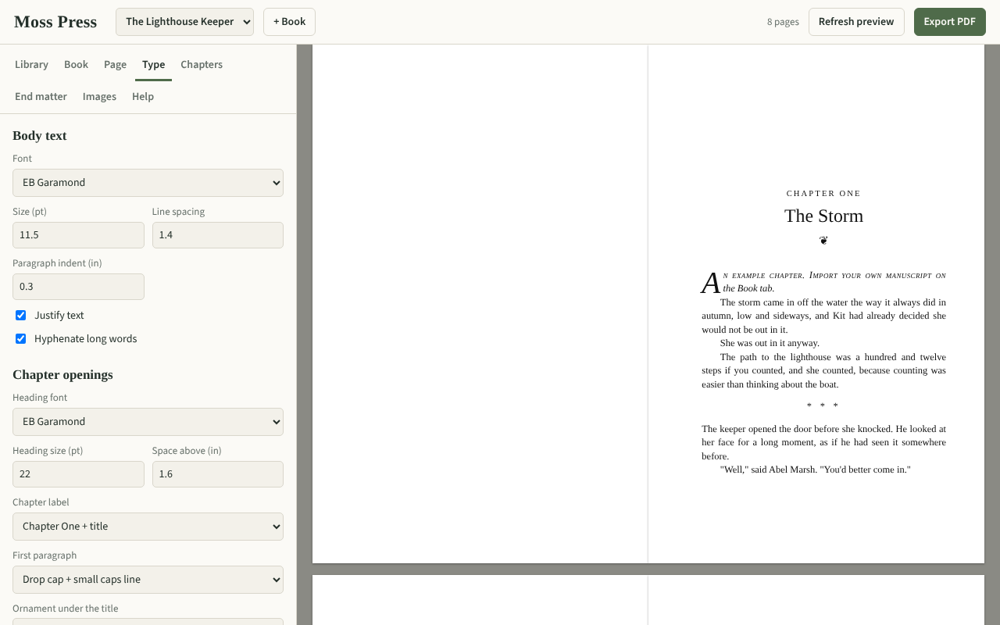

# Moss Press

Lay out your novel for print and save it as a PDF, ready for Amazon KDP or any print-on-demand service. Free, in your browser, nothing to install.

**Try it now:** [lelula.github.io/Moss_Press](https://lelula.github.io/Moss_Press/)

Pick a trim size and margins, choose your fonts, and set how every chapter opens: label, title, ornament, drop cap and small caps. Moss Press repeats that look through the whole book, mirrors left and right pages, numbers pages from Chapter 1, builds the table of contents, and adds your end matter. The preview shows real two-page spreads as you go.

Made for writers who want a Vellum-style formatter on Windows (or anywhere) without paying for Word.

## Where your books live

The first time you open it, Moss Press asks where your books should live.

- **A folder on this computer** (Chrome or Edge on a computer). Every book is a folder of plain text files you own, and the whole library sits in one folder. Your AI agent can read and update the files, so it can fix a typo across ten books or change your "Also by" page once for all of them. Give it [AGENTS.md](AGENTS.md).
- **Just this browser.** For trying it out. Your books stay inside that one browser. Use **Download everything** or **Save project file** now and then to keep a copy.

You can move from the browser to a folder later; your books come along.

**Works with the [Moss Writing Desk](https://github.com/lelula/Moss-Writing-desk).** Point Moss Press at your Writing Desk folder and your books are already there, chapters and all. Write in the Desk, format in the Press, and never export between them.

**Privacy:** your text never leaves your computer. The page does fetch its fonts from Google Fonts and its page-layout engine ([Paged.js](https://pagedjs.org)) from unpkg, so stay online while you preview and export.

## Making the PDF

1. Press **Export PDF**. Your browser's print dialog opens.
2. Choose **Save as PDF** as the printer.
3. Set **Margins** to **None** and turn **Headers and footers** off.
4. Save. The page size comes from your trim size automatically, and the fonts are embedded, which is what KDP wants.

Moss Press can't run inside a Claude artifact, because artifacts aren't allowed to open the print dialog. Open it as a normal web page.

## What it does

- **Page:** trim sizes 5 × 8, 5.25 × 8, 5.5 × 8.5, 6 × 9, 8 × 10, 8.5 × 8.5, 8.5 × 11 or custom; mirrored margins; running headers; page numbers centered, on the outer corner, or off. It warns you if your inside margin is too small for KDP at your page count.
- **Type:** ten book fonts, size, line spacing, indents, justification and hyphenation.
- **Chapter openings:** "Chapter One", "Chapter 1", just the title, or no heading at all; drop cap and small caps; an ornament under the title, a symbol or your own drawn image; start every chapter on a right-hand page.
- **Scene breaks:** a line of `***` becomes your symbol, or your own drawn ornament image.
- **Front matter:** title page (typed, or your own title art), copyright page, dedication and table of contents, all unnumbered, each starting on the right-hand page like a printed book. Add a map, an epigraph or a cast list before Chapter 1.
- **End matter library:** About the Author, Also by, newsletter pages and so on, written once and reused in any book. Start from a template: covers with blurbs, a row of covers with captions, a list by series, or a thank-you page with your website. Each page can be left-aligned or centered.
- **Images:** author photos, covers, ornaments, title art and maps. `[[image:Map|full]]` fits a picture to the page.
- **Picture and coloring books:** add a stack of images at once and each becomes its own full page, centered, with no heading, header or page number, and a blank back if you want one. If you're using lots of big images, save to a folder rather than the browser.
- **Import:** one file for the whole book or one per chapter, plain text or Markdown. Choose how chapters split: at `# Heading` lines and lines like "Chapter 3" or "Prologue", at short title lines, at page breaks, or at a marker line you pick. Anything that lands wrong is quick to fix with **Split chapter at cursor** and **Join with next chapter**. Coming from Scrivener? Compile to Plain Text or MultiMarkdown with chapter titles on (MultiMarkdown keeps your italics).
- **Library:** all your books in one place, with a book switcher.
- **Themes:** Light, Dark, Sepia or Moss, matching the Moss Writing Desk. The pages stay white, because that's what prints.
- **Backups:** Download everything gives you every book, your end matter and your images as a zip of plain files. A project file carries one book anywhere.

## Which browser?

- **Chrome and Edge** on a computer: everything, including folder saving.
- **Other browsers** (Brave, Firefox, Safari): browser saving, project files and PDF export work; folder saving doesn't, because those browsers don't let web pages open folders.

## Shared as-is

This is a tool I made for my own books and decided to share. It is free and shared as-is. If it breaks, have your AI fix it. It is one HTML file, and AI is good at that.

Made by [LelulaGames](https://lelula.itch.io). If it helps you, a [tip on Ko-fi](https://ko-fi.com/lelulagames) is always appreciated. ♥

## License

MIT. Use it, change it, share it; keep the license and credit with it. See [LICENSE](LICENSE).
